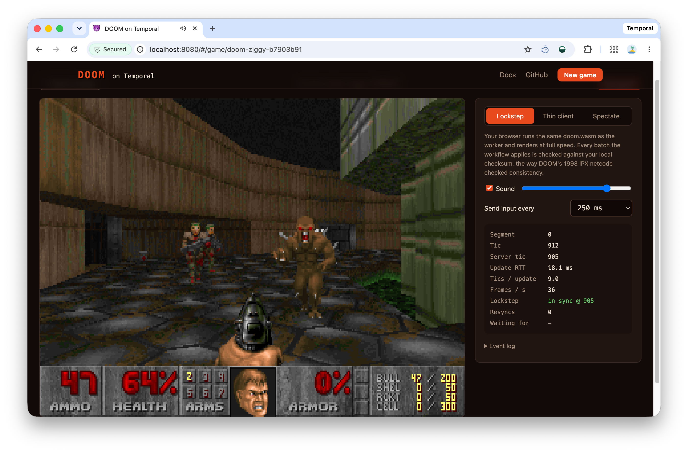

# Temporal DOOM

DOOM, running inside a [Temporal](https://temporal.io) workflow. Every game is
a workflow execution, every tic of player input is an Update in its history,
and every history is a demo you can play back, rewind, or fork.



> Not to be confused with the similarly slick,
> [Temporal Replay 2026 conference badge](https://temporal.io/blog/how-we-turned-replay-keynote-surprise-open-source-embedded-playground)
> ... which also played DOOM. Apparently Temporal's a big fan of the game.

All Go, no cgo: the engine is [gore](https://github.com/AndreRenaud/gore)
(a pure-Go port of doomgeneric), compiled to WebAssembly and run inside
workflow code with [wazero](https://wazero.io). The same `doom.wasm` also runs in
the browser, so clients can play in lockstep with the workflow.

How it works:

- [docs/overview.md](docs/overview.md): what "DOOM on Temporal" means. Tics,
  ticcmds, and why determinism makes a DOOM demo a Workflow history.
- [docs/system-architecture.md](docs/system-architecture.md): the browser,
  the web server, and the `DoomGame` Workflow, and how a tic flows through
  them.
- [docs/multiplayer.md](docs/multiplayer.md): DOOM's lockstep netcode, with
  the web server as the arbiter and the Workflow as recorder and referee.

## Running it

You need Go 1.26+ and the [Temporal CLI](https://docs.temporal.io/cli).

```sh
git submodule update --init
make                # downloads the shareware WAD, builds doom.wasm and the commands

make server-dev     # terminal 1: Temporal dev server (UI on http://localhost:8233)
make worker         # terminal 2: runs the DoomGame workflows
make web            # terminal 3: http://localhost:8080
```

Open http://localhost:8080, start a game, click the screen, and play. WASD or
arrows move, the mouse turns, click/Ctrl fires, E/Space uses, and Esc pauses.

To host your own copy on AWS against Temporal Cloud, at a domain of your own
(say, `doom.example.com`), see [infra/](infra/README.md): an example Pulumi
program for hosting the necessary services on AWS via ECS Fargate.

## Things to try

| | |
|---|---|
| **Multiplayer** | Start a *Co-op* or *Deathmatch* game, then open it in another tab (or browser) and click *join*. Up to 4 players can come and go. Esc pauses you: your marine stands still while everyone else plays on. The web server runs multiplayer games itself and records them in the workflow about once a second, so there can only be one server. To start some bots for testing, `uv run cmd/multiplayer-bot/multiplayer_bot.py --bots 3` adds dumb bots that run around shooting at random (see [cmd/multiplayer-bot](cmd/multiplayer-bot/README.md)). See [docs/multiplayer.md](docs/multiplayer.md). |
| **Crash-proof** | Kill the worker (`Ctrl-C`, or `kill -9`) mid-fight, then start it again. The game picks up where it was. |
| **Rewind** | Find the game in the Temporal UI, then *Reset* to an earlier Workflow Task. Or: `temporal workflow reset -w <id> -e <eventId> --reapply-exclude Update --reason rewind` |
| **Playback** | `./build/replay -id <id> -out game.gif` replays the history through Temporal's `WorkflowReplayer` and renders it. |
| **Desync** | Change gameplay code in `internal/game/workflow.go`, then replay an old game: `replay` reports the tic where it diverges. |
| **Search** | In the lobby, search `DoomMap = 'E1M1' AND DoomHealth < 50`. |
| **Thin client** | Switch the game to *Thin client*. Every frame is then one Update plus one Query. |
| **Sound** | On by default (click the game first, since browsers block autoplay). Lockstep plays the sounds your own engine produces; thin clients and spectators get them from the `frame` Query. |
| **Cross-runtime** | `temporal workflow query -w <id> --type sync -o json > s.json && temporal workflow query -w <id> --type frame --input 0 -o json > f.json && node web/test/lockstep.mjs s.json f.json` checks that V8 and wazero agree on state and sounds. |

## Layout

```
engine/               DOOM as a WASI reactor (GOOS=wasip1, //go:wasmexport)
internal/doomvm/      wazero host: one sandboxed engine per game, no clock/FS/network
internal/game/        the DoomGame workflow, activities, and client helpers
cmd/worker/           Temporal worker
cmd/server/           HTTP server: browser client + JSON API over Updates/Queries
cmd/replay/           history -> WorkflowReplayer -> GIF/PNGs + desync check
cmd/multiplayer-bot/  dumb bots (Python) that join a multiplayer game and run around shooting
infra/                example Pulumi program: host the web server and worker on ECS Fargate
web/                  browser client (engine.js runs doom.wasm, audio.js plays sounds, app.js is the UI)
third_party/gore/     submodule: upstream gore
```

### The gore submodule

`third_party/gore` tracks the `main` branch of upstream
[gore](https://github.com/AndreRenaud/gore).

`gore` features:

- **A deterministic step mode.** The engine never reads the wall clock, keeps
  savegames in memory, and panics from `i_Error` instead of spinning forever.
- **A step API.** `StepInit`, `StepTic`, `StepRender`, `GetStats`,
  `Checksum`, `SaveGameBytes`, and `LoadGameBytes`, plus a deterministic
  sound module that queues events (`StepSoundEvents`), timed by tics.
- **Multiplayer.** `StepNetTic` runs a tic for every player, with players
  joining (spawning mid-level) and leaving between tics. `StepSetView` picks
  whose eyes to render, and `Checksum` covers every player.
- **Savegame fixes**, for crashes and hangs found by the continue-as-new path.

## Tests

```sh
make test
```

The tests check that:
- Engines fed the same input agree, regardless of batching or rendering.
- Snapshots resume deterministically.
- The workflow's validator, continue-as-new, and idle timeout behave as intended.
- The leaderboard activity records and orders results.
- Snapshots survive being chained 120 times, the way continue-as-new chains them.
- Sound events come back through the `frame` Query, and every bullet fired is heard.
- gore's step API works and survives a save on every tic.
- Multiplayer engines looking through different players' eyes stay in
  lockstep through joins, leaves, deaths and snapshots, in co-op and
  deathmatch.
- The server's multiplayer sequencer merges input, waits for (and gives up
  on) slow players, and handles pause, rejoin and leave. Its rooms stream
  tics over WebSockets, record them in batches, and recover from lost
  replies and Resets.
- The multiplayer workflow referees recorded tics (cheats, impossible joins
  and leaves) and carries the roster across continue-as-new.

## Licensing

Copyright (c) 2026 Temporal Technologies Inc.

Temporal-authored source, docs, and website content use the
[GNU General Public License, version 2](LICENSE) unless a file or notice says
otherwise.

The engine is built from [gore](https://github.com/AndreRenaud/gore), which is
also GPL-2.0 and derived from id Software's
[DOOM source code](https://github.com/id-Software/DOOM). The shareware
`doom1.wad` game data is not covered by the GPL and has separate terms. See
[`THIRD_PARTY_NOTICES.md`](THIRD_PARTY_NOTICES.md) and [`licenses/`](licenses/).
