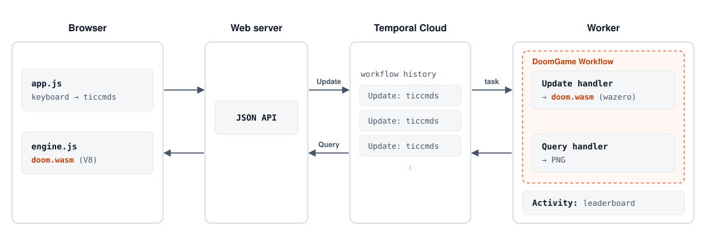

# System architecture

This document walks through the whole system: the browser that plays the
game, the small Go web server between it and Temporal, and the `DoomGame`
Workflow that runs DOOM. For *why* DOOM fits a Workflow at all, read
[overview.md](overview.md) first. Multiplayer builds on everything here and
is covered in [multiplayer.md](multiplayer.md).

## The big picture



There are four moving parts:

| Component | Code | Role |
| --- | --- | --- |
| Browser client | [`web/`](../web) | Turns the keyboard and mouse into ticcmds, runs its own copy of `doom.wasm`, and draws the game. |
| Web server | [`cmd/server`](../cmd/server) | Serves the client, and turns its JSON API into Temporal SDK calls. In multiplayer, it also merges players' input (see [multiplayer.md](multiplayer.md)). |
| Temporal | Temporal Cloud, or `temporal server start-dev` | Records each game's history and hands work to the Worker. |
| Worker | [`cmd/worker`](../cmd/worker), [`internal/game`](../internal/game) | Runs the `DoomGame` Workflow, which runs DOOM, and the leaderboard Activity. |

The DOOM engine itself is [`engine/`](../engine) (a thin WASI wrapper
around [gore](https://github.com/AndreRenaud/gore)), compiled to
`build/doom.wasm`. The *same file* runs in the browser and in the Worker,
which is what lets them check each other.

## The engine: `doom.wasm`

[`engine/main.go`](../engine/main.go) exports a small ABI from DOOM to its
host: load the WAD, start a game, run ticcmds (`doom_tics`, or
`doom_net_tics` for multiplayer), render a frame, report stats, compute a
checksum, save and load a game, and drain sound events.

On the server side, [`internal/doomvm`](../internal/doomvm) hosts it under
wazero. Each game gets its own WebAssembly instance, so one Worker can run
many games even though gore keeps its state in global variables. The
sandbox has no filesystem, no network, and a fake clock fixed at DOOM's
release date, so the engine can't do anything non-deterministic. Booting a
game takes about 15ms, well within a Workflow task.

The engine's **version** is a hash of `doom.wasm` and the WAD
(`doomvm.VersionOf`). The build is reproducible (`-trimpath
-buildvcs=false`), so a local build and the Docker image produce the same
version.

In the browser, [`web/engine.js`](../web/engine.js) runs the same module
under V8 with a minimal WASI shim.

## The browser client

[`web/app.js`](../web/app.js) runs at DOOM's 35 tics per second, turning
input into one ticcmd per tic. A single-player game can be played in two
modes:

- **Lockstep** (the default). The browser runs each tic through its own
  `doom.wasm` straight away and renders it at full speed, without waiting
  for the Worker. It sends the accumulated ticcmds to the server in batches,
  one request in flight at a time. When the Workflow acknowledges a batch,
  the browser compares the Workflow's checksum with its own for that tic. If
  they ever disagree, it **resyncs**: it fetches the `sync` Query (the
  run's starting snapshot plus every ticcmd since), boots a fresh engine,
  and replays it.
- **Thin client.** The browser doesn't run DOOM at all. Every frame is one
  Update (send ticcmds) followed by one Query (fetch the frame the Workflow
  rendered, as a PNG). It's slow, but it shows that the Workflow really is
  running the game.

Sound works in both modes. The engine reports sound events per tic, so the
browser plays its own in lockstep, and thin clients get them from the
`frame` Query.

Each browser tab has a random player ID, sent with every request in the
`X-Doom-Player` header.

## The web server

[`cmd/server`](../cmd/server) is deliberately small. It embeds and serves
the client (`web/`), `doom.wasm` and `doom1.wad`, and maps a JSON API onto
the Temporal SDK:

| Endpoint | Temporal call |
| --- | --- |
| `POST /api/games` | `ExecuteWorkflow`: start a new `DoomGame` |
| `GET /api/games` | `ListWorkflow`: running games, with optional search (`?q=DoomMap = 'E1M1'`) |
| `POST /api/games/{id}/tics` | `UpdateWorkflow` `tics`: apply a batch of ticcmds (single player) |
| `POST /api/games/{id}/quit` | `UpdateWorkflow` `quit` |
| `GET /api/games/{id}/frame` | `QueryWorkflow` `frame`: the current frame as a PNG, with stats and sounds in headers |
| `GET /api/games/{id}/state` | `QueryWorkflow` `state`: stats, roster, engine version |
| `GET /api/games/{id}/sync` | `QueryWorkflow` `sync`: everything needed to rebuild the game locally |
| `GET /api/games/{id}/net` | WebSocket to the game's multiplayer room (see [multiplayer.md](multiplayer.md)) |
| `GET /api/leaderboard` | Reads the leaderboard file the Activity writes |

Two pieces of state live in the server's memory:

- **Leases** ([`lease.go`](../cmd/server/lease.go)) stop two people from
  playing the same single-player game by accident. Whoever sent input most
  recently owns the game for 10 seconds.
- **Multiplayer rooms** ([`internal/netplay`](../internal/netplay)), one
  per multiplayer game someone is connected to.

Because rooms live in one process, there can only be **one web server**.
That's fine for this project (the example deployment in `infra/` runs one task), and nothing is
lost if it restarts: games live in Temporal.

## The `DoomGame` Workflow

[`internal/game/workflow.go`](../internal/game/workflow.go) is the heart of
the system. Stripped down, it looks like this:

```go
func (w *Workflows) DoomGame(ctx workflow.Context, in GameInput) (Summary, error) {
	// Refuse to replay a game recorded with a different engine.
	// Boot DOOM from the config, or from in.Snapshot after a continue-as-new.
	vm, _ := w.Engine.NewVM(context.Background(), cfg.options(in.Snapshot))
	defer vm.Close()

	workflow.SetUpdateHandlerWithOptions(ctx, "tics", g.onTics,
		workflow.UpdateHandlerOptions{Validator: g.validateTics})
	workflow.SetUpdateHandler(ctx, "quit", ...)
	workflow.SetQueryHandler(ctx, "frame", g.onFrameQuery)
	workflow.SetQueryHandler(ctx, "state", ...)
	workflow.SetQueryHandler(ctx, "sync", ...)

	// No game loop: just wait until it's time to quit, give up on an idle
	// game, or roll over into a new run.
	workflow.AwaitWithTimeout(ctx, idleTimeout, func() bool {
		return g.quit || g.shouldContinueAsNew()
	})
	...
}
```

### Updates carry input

Temporal has several ways to
[send messages to a Workflow](https://docs.temporal.io/encyclopedia/workflow-message-passing).
An **Update** is a durable write that returns a result, which is exactly
what input needs.

The `tics` Update carries a `TicBatch`: the tic it starts at and a list of
ticcmds.

1. The **validator** rejects bad input before it's recorded: a batch that
   doesn't start at the game's current tic, more than 105 tics (3 seconds)
   at once, movement beyond DOOM's limits, or the pause/save "special"
   buttons. A rejected Update leaves no trace in history.
2. The **handler** checks the starting tic again (Updates can be delivered
   together, and this is what makes retries idempotent), runs the ticcmds through the engine,
   and returns a small `TicResult`: the stats and the checksum.

The result is tiny on purpose. The client runs the same engine, so it
doesn't need to be told what changed, only that its input was accepted and
what the checksum should be.

### Queries carry pixels

A **Query** is a read-only request that isn't recorded in history, so it's
the right place for anything big or frequent:

- `frame` renders the current game state to a PNG (64 KB of raw pixels per
  frame would fill a history quickly if it went in Update results).
  Rendering only touches renderer state, never the simulation, so it's safe
  to do lazily from a Query. In multiplayer it takes a `view` argument, to
  watch any player.
- `state` returns stats, deaths, completed levels and the roster.
- `sync` returns the run's starting snapshot and every ticcmd since, so a
  client can rebuild the game exactly.

### Activities touch the outside world

Anything non-deterministic runs as an
[Activity](https://docs.temporal.io/activities). After each batch, the
Workflow compares the game's state before and after. If it went from
playing a level to the intermission (or the E1M8 finale), the player
finished a level, and the Workflow starts the `RecordLevel` Activity to add
it to the leaderboard.

The Workflow doesn't wait for it, since a slow leaderboard shouldn't stall
the game. It only waits for outstanding Activities just before the run
ends. If the leaderboard is down, Temporal retries the Activity, and the
player never notices.

The Workflow also keeps search attributes up to date (`DoomPlayer`,
`DoomMap`, `DoomHealth`, `DoomKills`, `DoomDeaths`, and in multiplayer
`DoomMode` and `DoomPlayers`), which the lobby uses to list and search
games. The Worker registers them at startup if they're missing.

### Continue-as-New: the savegame trick

A run's history can't grow forever. After 1,000 Updates (300 `record`
Updates in multiplayer, about 5 minutes), or sooner if Temporal reports
`GetContinueAsNewSuggested()`, the Workflow:

1. waits for in-flight Updates and leaderboard Activities to finish,
2. saves the game with DOOM's own savegame code (about 25 KB), and
3. [continues as new](https://docs.temporal.io/workflow-execution/continue-as-new),
   passing the savegame, the engine version, and the running totals as the
   next run's input.

The next run loads the snapshot and carries on. Clients don't need to
know, because Updates are addressed to the Workflow ID, which always
reaches the newest run. They do resync when they notice a new run
(`segment`), because DOOM's savegames leave out a little state, so a
resumed game doesn't play out exactly like one that never stopped.

### Ending a game

A game ends when the player quits (the `quit` Update), or when a whole
idle period (30 minutes by default) passes with no input.

## How a tic flows through the system

Follow one batch of single-player input, in lockstep mode:

1. The browser makes a ticcmd every 1/35s, runs it through its local
   engine, draws the frame, and remembers its checksum.
2. When the previous request has returned, it `POST`s everything that has
   accumulated to `/api/games/{id}/tics`.
3. The server checks the lease and calls `UpdateWorkflow`.
4. Temporal schedules a Workflow task. The Worker runs the validator, then
   the handler, which runs the ticcmds through the Worker's engine.
5. Temporal durably records the Update in history, then returns the result.
6. The browser compares the returned checksum with its own at that tic.

Nothing in the player's experience waits on steps 2–6. The browser has
already drawn those tics. If the Worker is down, Updates wait until one
comes back, and the game resumes from history.

## What happens when things fail

| Failure | What happens |
| --- | --- |
| The Worker crashes | Another Worker (or the same one, restarted) replays the history and the game continues. The player sees one slow Update. |
| The engine traps | The handler panics, which fails the Workflow *task*, not the Workflow. The history is intact and Temporal retries, so a fixed Worker (or a Reset) can recover the game. |
| A Worker runs a different engine | It refuses to replay the game (the engine version is recorded with `workflow.SideEffect`), and the task retries until a Worker with the right engine takes it. `make purge-all-games` is the blunt way to upgrade the engine; [Worker Versioning](https://docs.temporal.io/production-deployment/worker-deployments/worker-versioning) is the proper one. |
| The browser and Workflow disagree | The browser resyncs from the `sync` Query. |
| The web server restarts | Single-player games are unaffected. Multiplayer games lose up to a second of unrecorded tics, and browsers reconnect and resync. |

## Deployment

[`infra/`](../infra) is an example Pulumi program for hosting your own copy
on AWS ECS Fargate, at a domain of your own: one task with two containers built from the repo's
[`Dockerfile`](../Dockerfile), the web server and the Worker, behind an
ALB, talking to Temporal Cloud. The task runs on Fargate Spot. A game
survives its Worker being reclaimed, because Temporal hands it to the
replacement, which rebuilds it from history.

Locally, `make server-dev`, `make worker` and `make web` run the same
pieces against the Temporal dev server (see the
[README](../README.md#running-it)).

## Tools

- [`cmd/replay`](../cmd/replay) replays a game's history through Temporal's
  `WorkflowReplayer`, checks for non-determinism, and renders it to a GIF
  or PNGs.
- [`cmd/multiplayer-bot`](../cmd/multiplayer-bot) adds dumb bots to a
  multiplayer game.
- [`web/test/lockstep.mjs`](../web/test/lockstep.mjs) checks that V8 and
  wazero agree on a game's state and sounds.
